# Diagrama de nodos — campaña de *El Eternauta*

**Estado:** validado para preproducción.
**Propósito:** convertir `00-plan.md` en una red navegable. Este artefacto define conexiones, bloqueos, repetidoras, refugios y retornos; no autoriza implementación Godot todavía.

## Leyenda

- **R**: repetidora; revela el mapa local, auxilios y estado de rutas.
- **F**: refugio; punto seguro, atajo o soporte de supervivientes.
- **[bloqueo]**: requisito para cruzar una conexión.
- **Ruta principal**: acerca el objetivo narrativo actual.
- **Ruta opcional**: aporta rescate, recursos, información o un atajo.

## Red macro

```mermaid
flowchart LR
    C[Chalet de Vicente López\nF: familia] -->|traje aislante| VN[VL norte: calles y techos bajos\nR-1 radio barrial]
    C -->|traje aislante| VS[VL sur: garajes y comercios\nF-1 refugio vecinal]
    VN <--> VS
    VN -->|radio + señal| GP[General Paz y depósitos\nF-2 puesto militar]
    VS -->|escopeta: barricada| GP
    GP -->|misión de auxilio| RI[River Plate\nR-2 base de resistencia\nF-3 River]
    RI -->|kit: ascensor/puente| GB[Barrancas de Belgrano\nR-3 casona médica]
    GB -->|filtros: túnel contaminado| SU[Subterráneos de Belgrano\nF-4 estación segura]
    SU -->|filtros: paso bajo tierra| CE[Centro y Congreso\nR-4 central civil\nF-5 Congreso]
    CE -->|bombas: derrumbe| PM[Puesto de los Manos\nR-5 señal invasora]
    PM -->|decodificador: compuerta| NA[Nave invasora]
    NA --> FT[Fractura temporal]

    GP -. escopeta: garaje/barricada .-> VS
    RI -. kit: ascensor .-> GP
    RI -. kit: puente de servicio .-> VN
    SU -. filtros: desagüe .-> VS
    CE -. bombas: muro agrietado .-> GB
    CE -. bombas: derrumbe .-> GP
    PM -. decodificador: puerta invasora .-> CE
```

Las aristas punteadas son retornos deliberados. Deben sentirse como conexiones nuevas —no como el mismo corredor recorrido en sentido inverso— y quedar visibles antes de obtener su requisito cuando sea posible.

## Nodos y conexiones

| Nodo | Función y elementos | Salidas disponibles | Bloqueos visibles / retornos futuros |
|---|---|---|---|
| **C — Chalet de Vicente López** | Prólogo, familia y fabricación. `F: familia`; croquis incompleto. | `VN` por ventana/techo bajo; `VS` por salida principal. Ambas requieren traje aislante. | Puerta exterior con nieve letal. Dos primeras rutas exteriores evitan que el traje sea una llave de uso único. |
| **VN — Vicente López norte** | Calles residenciales, techos bajos y radio barrial `R-1`. | `VS` por pasaje; `GP` tras activar la radio y seguir la señal; vuelta a `C`. | Puente de servicio hacia `RI` `[kit]`; acceso de techo seguro hacia `C` `[traje]`. |
| **VS — Vicente López sur** | Garajes, comercios, primer `F-1` y acceso a desagüe. | `VN` por pasaje; `C`; `GP` por barricada debilitada `[escopeta]`. | Garaje/refugio cerrado `[escopeta]`; desagüe contaminado hacia `SU` `[filtros]`; refugio cambia de estado al pedir ayuda por radio. |
| **GP — General Paz y depósitos** | Frontera de guerra, `F-2`, misión de auxilio y entrega de escopeta. | `RI` por ruta militar inicial; retorno corto a `VS` `[escopeta]`. | Puente logístico a `RI` `[kit]`; derrumbe hacia `CE` `[bombas]`; depósitos opcionales `[escopeta]`. |
| **RI — River Plate** | Base de resistencia, `R-2`, `F-3`, nodo de teledirección y kit de reparación. | `GB` por ascensor/puente `[kit]`; retorno a `GP` `[kit]`; retorno alto a `VN` `[kit]`. | Estructuras verticales fuera de servicio `[kit]`; consola invasora `[decodificador]`. |
| **GB — Barrancas de Belgrano** | Casonas, andamios, célula médica `R-3`; obtención de filtros/sellado. | `SU` por túnel contaminado `[filtros]`; `RI` por puente reparado. | Paso a `CE` por pared agrietada `[bombas]`; conductos contaminados hacia `VS` `[filtros]`. |
| **SU — Subterráneos de Belgrano** | Túneles inundados, `F-4` y cruce subterráneo. | `CE` por paso bajo tierra `[filtros]`; retorno a `GB`; desagüe a `VS` `[filtros]`. | Sectores anegados, nidos y compuertas de servicio; una repetidora aislada se reconecta desde `R-3`. |
| **CE — Centro y Congreso** | Ciudad ocupada, `R-4`, `F-5`, resistencia central y bombas improvisadas. | `PM` por derrumbe `[bombas]`; retornos a `GB` y `GP` `[bombas]`; acceso por `SU`. | Compuertas invasoras `[decodificador]`; muros agrietados y derrumbes `[bombas]`. |
| **PM — Puesto de los Manos** | Señal invasora `R-5`, encuentro moral y decodificador. | `NA` por compuerta `[decodificador]`; atajo de vuelta a `CE` `[decodificador]`. | Terminales y puertas invasoras distribuidas en `CE`, `RI` y el acceso final `[decodificador]`. |
| **NA — Nave invasora** | Infiltración, reencuentro familiar y mecanismo temporal. | `FT` al activar el escape. | Ruta final formada por accesos ya abiertos y apoyo de la red; no entrega movilidad ni armas nuevas. |
| **FT — Fractura temporal** | Epílogo: Juan se convierte en el Eternauta. | Sin retorno jugable. | Cierre narrativo, no jefe final militar. |

## Red de resistencia: estados que cambian el mapa

| Hito de red | Cambio persistente | Impacto en navegación |
|---|---|---|
| `R-1` Radio barrial de VL | Revela `F-1`, auxilios de `GP` y dos rutas exteriores seguras. | Hace visible el objetivo de General Paz y permite elegir norte/sur para volver. |
| Auxilio en `F-2` | Los militares sostienen el paso inicial hacia River. | Abre la ruta principal `GP → RI` y marca barreras rompibles para la escopeta. |
| `R-2` River | Actualiza rutas de resistencia y pedidos de técnico/médicos. | Señala el retorno del kit hacia `GP`/`VN` y la ubicación de `R-3`. |
| `R-3` Barrancas | Reconecta la célula médica y anuncia sectores contaminados. | Muestra `SU → CE` y el retorno `SU → VS` cuando se obtienen filtros. |
| `R-4` Centro | Coordina evacuación y revela el Puesto de los Manos. | Abre misiones de apoyo que habilitan bombas y atajos centrales. |
| `R-5` Señal invasora | Identifica terminales, compuertas y ruta de la nave. | Hace legibles las puertas del decodificador; no sustituye la exploración física. |

## Matriz de progresión y retornos

La matriz comprueba la regla de diseño: cada equipo/arma abre dos usos útiles fuera de su zona de obtención. Los dos usos del traje son las dos salidas físicas distintas del prólogo, necesarias para que la primera exploración tenga una elección real.

| Obtención | Zona de obtención | Ruta principal que abre | Retorno útil adicional | Validación |
|---|---|---|---|---|
| Traje aislante | `C` | `C → VN` para alcanzar `R-1`. | `C → VS` para `F-1`, recursos y otro acceso futuro a GP. | Cumple: dos salidas exteriores con geografía/objetivo distintos. |
| Radio portátil + `R-1` | `VN` | Señal hacia `GP` y ruta de auxilio. | Revela `F-1` y la alternativa norte/sur de VL; prepara el refugio de retorno desde GP. | Cumple: información y red modifican rutas, no el movimiento. |
| Escopeta | `GP` | `VS → GP` por barricada debilitada. | Garaje/refugio cerrado de `VS` y depósitos opcionales de `GP`. | Cumple: un retorno principal y dos opcionales. |
| Kit de reparación | `RI` | `RI → GB` por ascensor/puente. | `RI → GP` por puente logístico y `RI → VN` por pasarela alta. | Cumple: dos retornos a zonas anteriores. |
| Filtros/sellado | `GB` | `SU → CE` por túnel contaminado. | `SU → VS` por desagüe, con rescate/atajo a `F-1`. | Cumple: ruta principal y retorno al barrio inicial. |
| Bombas improvisadas | `CE` | `CE → PM` al despejar el derrumbe. | `CE → GB` por muro agrietado y `CE → GP` por derrumbe de servicio. | Cumple: dos retornos que recomponen el mapa. |
| Decodificador alienígena | `PM` | `PM → NA` por compuerta final. | Terminal de `CE` y consola de `RI`, que abren recursos/lore y un atajo de red. | Cumple: acceso final y dos usos previos distribuidos. |

## Decisiones y límites de implementación posterior

1. Los bloqueos representan **equipo, armas o cambios de red**, nunca doble salto, dash, wall-jump ni poderes.
2. Cada conexión debe indicar en el nivel físico una alternativa creíble: escaleras, techos bajos, ascensores, puertas, túneles, tablones, puentes o derrumbes.
3. Un refugio no es sólo un checkpoint: debe cambiar una ruta, dar soporte a una misión o hacer más corto un retorno.
4. La ruta crítica usa una cadena entendible `C → VL → GP → RI → GB/SU → CE → PM → NA`; el mapa conserva bucles y atajos para que los retornos no sean lineales.
5. Antes de construir escenas, el vertical slice debe limitarse a `C → VN/VS`: fabricar el traje, elegir una salida y pisar la nevada. La radio/repetidora pertenece al siguiente hito.
