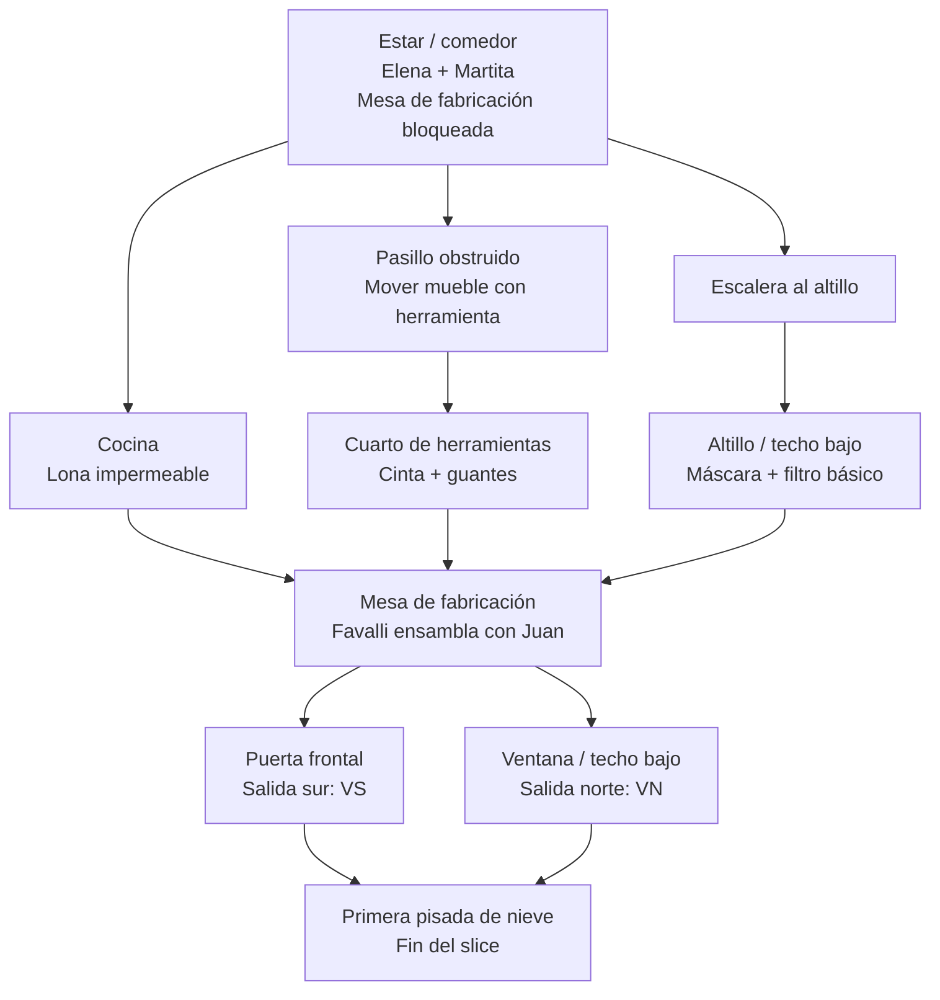

# Diseño del vertical slice — Chalet → primera salida a la nevada

**Estado:** validado para preproducción.
**Dependencias de diseño:** `../../00-plan.md`, `../01-mapa/01-diagrama-nodos.md` y `docs/LORE_ORIGINAL_EL_ETERNAUTA.md`.
**Propósito:** definir el primer tramo jugable completo antes de modificar Godot. El slice valida vulnerabilidad, cooperación, fabricación y movilidad urbana realista; no pretende validar todavía el mapa de resistencia ni el combate avanzado.

## Objetivo de experiencia

En 12–18 minutos, el jugador debe pasar de estar protegido pero encerrado en el chalet a **fabricar colectivamente un traje aislante y elegir una primera salida hacia la ciudad nevada**. Al cruzar el umbral, debe entender tres ideas:

1. La nevada es mortal sin preparación.
2. Juan no progresa por poderes: progresa porque el grupo aporta conocimiento, materiales y ayuda.
3. El exterior ofrece dos direcciones físicas distintas —norte y sur de Vicente López—, aunque el vertical slice termina al entrar en cualquiera de ellas.

## Alcance del slice

### Incluido

- Chalet habitable con planta baja, escalera, altillo/techo bajo y salida frontal.
- Juan, Elena, Martita, Favalli y al menos un amigo como presencias narrativas/interactivas.
- Recolección de tres componentes de traje en espacios que enseñan acciones físicas.
- Mesa de fabricación cooperativa y traje aislante como único desbloqueo.
- Una salida exterior por `VN` o `VS`, marcada como elección inicial.
- Peligro de nevada visible desde el comienzo y un único evento corto de vulnerabilidad ambiental.
- Croquis incompleto del chalet: no mapa completo ni marcador de objetivos fuera de la casa.
- Herramienta contundente inicial sólo para apartar una obstrucción ligera; sin combate obligatorio.

### Fuera de alcance

- Radio portátil, repetidoras, mapa revelado, refugios externos y pedidos de auxilio.
- Cascarudos, supervivientes hostiles, jefes y bucles de combate.
- Escopeta, filtros, kit de reparación, bombas y decodificador.
- Doble salto, dash, wall-jump, inventario complejo, crafteo libre o árbol de habilidades.
- General Paz y cualquier área posterior a `VN`/`VS`.

## Espacio y recorrido

### Diseño de salas

| Espacio | Acción física que enseña | Recompensa / función | Señal narrativa |
|---|---|---|---|
| Estar / comedor | Interacción, hablar y observar el exterior. | Activa la tarea de ayudar a Favalli; la mesa muestra los tres huecos de componentes. | Elena protege a Martita; se oye la radio doméstica fallar y la nieve golpear las ventanas. |
| Cocina | Abrir alacena y mover una silla baja. | Lona impermeable. | Lista de compras y vasos a medio usar subrayan la interrupción abrupta de la vida cotidiana. |
| Pasillo obstruido | Apartar un mueble ligero con la herramienta; no destruirlo. | Acceso al cuarto de herramientas. | Una ventana deja ver nieve acumulada contra la puerta trasera. |
| Cuarto de herramientas | Buscar en estantes bajos y arrastrarse bajo una viga caída. | Cinta selladora y guantes. | Nota de Favalli sobre sellar uniones; anticipa el traje como solución colectiva, no como botín mágico. |
| Escalera / altillo | Subir una escalera estable, pasar bajo techo bajo y cruzar un tablón corto. | Acceso a máscara y filtro básico. | Desde una ventana alta, Juan ve una calle desierta y una silueta/huella ambigua a distancia. |
| Mesa de fabricación | Entregar los tres componentes; diálogo breve y confirmación. | Traje aislante equipado automáticamente. | Favalli explica el límite: el traje permite salir, no vuelve segura la ciudad. |
| Salidas | Elegir puerta frontal o ventana/techo bajo. | Entrada a `VS` o `VN`; fundido/corte de fin de slice tras la primera pisada. | Elena pide volver; Martita deja una pista visual/emocional que vincula el futuro reencuentro. |

## Flujo jugable y beats narrativos

1. **Apertura — encierro y amenaza (0–2 min).** Juan despierta/recupera el control en el estar. La puerta exterior tiene nieve acumulada, la ventana muestra visibilidad baja y el intento de abrir sin traje produce una advertencia clara más una retirada inmediata; no hay daño ni muerte tutorial.
2. **Objetivo colectivo (2–3 min).** Favalli identifica que faltan lona, sellado/guantes y máscara/filtro. Elena cuida a Martita y contextualiza la urgencia; cada personaje aporta una pieza de información, no una lista de recados despersonalizada.
3. **Exploración interior (3–10 min).** El jugador puede recoger los tres componentes en cualquier orden. Cada rama contiene una sola acción física creíble: mover, subir, arrastrarse o cruzar un desnivel corto. Ninguna exige precisión de plataforma ni una segunda pulsación de salto.
4. **Fabricación (10–13 min).** Cuando están las tres piezas, la mesa cambia de estado. Juan coloca los materiales y Favalli completa el sellado. El traje se equipa en escena; el diálogo deja claro que el grupo hizo posible la salida.
5. **Primera elección exterior (13–16 min).** Se habilitan la puerta frontal a `VS` y la ventana/techo bajo a `VN`. Cada salida muestra un encuadre distinto: garajes/comercios al sur, casas/techos bajos al norte.
6. **Cierre (15–18 min).** La primera pisada en nieve con traje dispara el título de zona correspondiente y cierra el vertical slice. No se activa radio ni aparece un objetivo de combate; el siguiente hito de diseño será la radio/repetidora barrial.

## Estados del juego que debe expresar la futura implementación

| Estado | Cambio observable | Regla de transición |
|---|---|---|
| `encerrado` | Mesa bloqueada; las dos salidas exteriores rechazan el paso. | Estado inicial. |
| `componente_obtenido` | Se marca uno de tres huecos de la mesa; un personaje reacciona de forma breve. | Recoger lona, sellado/guantes o máscara/filtro. |
| `materiales_completos` | Favalli invita a usar la mesa; las salidas aún siguen bloqueadas. | Tener los tres componentes. |
| `traje_equipado` | Cambio visual en Juan; croquis marca dos salidas; clima deja de bloquear el umbral. | Completar la escena de fabricación. |
| `exterior_iniciado` | Título `Vicente López norte` o `Vicente López sur`; cierre del slice. | Cruzar una de las dos salidas con traje. |

Los componentes no deben perderse, combinarse libremente ni admitir recetas alternativas en este hito. La futura implementación puede representar los estados con flags simples; no se justifica un sistema genérico de inventario/crafteo.

## Contrato de control y traversal

| Acción | Uso dentro del slice | Restricción |
|---|---|---|
| Caminar / correr corto | Recorrer habitaciones y aproximarse a interacciones. | Sin aceleración heroica ni atravesar peligros ambientales. |
| Salto humano único | Cruzar un desnivel o alcanzar un tablón bajo. | Nunca encadena un segundo salto. |
| Interactuar | Recoger, hablar, abrir, usar la mesa. | Contextual y con una única intención por objeto. |
| Herramienta contundente | Apartar obstrucción ligera del pasillo. | No destruye paredes ni inicia un combate obligatorio. |
| Agacharse / arrastrarse | Pasar bajo viga en el cuarto de herramientas. | Ritmo lento y legible; no es una habilidad desbloqueable. |

No se expone una acción de dash. Si el prototipo aún la configura, su retiro forma parte de la fase de implementación y debe ser cubierto por pruebas antes de activar este slice.

## Criterios de aceptación de diseño

El vertical slice estará correctamente representado cuando una partida nueva permita demostrar todos estos puntos:

1. Juan no puede abandonar el chalet sin el traje y la nevada comunica claramente el peligro.
2. Los tres materiales se pueden obtener en orden libre, sin doble salto, dash, wall-jump ni poderes.
3. Cada material se vincula a una acción física realista distinta y a una pista narrativa del grupo.
4. Fabricar el traje requiere los tres componentes y una interacción visible con Favalli; no basta con recoger un pickup.
5. Tras fabricar, el jugador puede elegir dos primeras salidas físicamente distintas: `VN` o `VS`.
6. Ambas rutas terminan el slice con la primera pisada en nieve; ninguna abre radio, combate obligatorio, mapa completo o zona posterior.
7. El cierre deja una señal breve sobre Elena/Martita sin resolver su arco ni desplazar el foco de supervivencia colectiva.

## QA manual posterior a la implementación

| Caso | Pasos | Resultado esperado |
|---|---|---|
| Bloqueo climático | Intentar cada salida sin traje. | Retroalimentación de peligro y permanencia dentro del chalet. |
| Orden libre | Obtener los tres componentes en las seis permutaciones posibles. | La mesa sólo se habilita al obtener el tercero; no hay bloqueos de orden. |
| Movilidad humana | Completar cada rama sin usar dash/doble salto. | Todas las rutas son transitables con acciones físicas básicas. |
| Fabricación | Intentar usar la mesa con cero, uno, dos y tres componentes. | Sólo tres componentes activan la escena/equipamiento. |
| Dos salidas | Completar una partida por puerta frontal y otra por ventana/techo. | Ambas producen el cierre correcto y el título de zona correspondiente. |
| Límite de alcance | Tras el cierre, buscar radio, combate o acceso a General Paz. | No están presentes ni se anuncian como objetivos activos. |

## Decisiones cerradas

- El traje aislante es una **capacidad ambiental** y no modifica el set de movimientos.
- Las dos salidas validan la primera elección espacial, pero no convierten el slice en una bifurcación de contenido: ambas cierran tras el umbral.
- El primer peligro enseña a retroceder y prepararse; no castiga con muerte, checkpoint ni combate.
- La fabricación es guiada y cooperativa. Un sistema de crafting abierto queda fuera de alcance hasta que la campaña lo justifique.
- La radio/repetidora comienza después de este slice, en el siguiente hito de Vicente López.
